# Conecta do Bem – Sprint 1

## Título e descrição
**Conecta do Bem** é uma proposta de plataforma criada no Challenge FIAP (1TDS) para a **Turma do Bem**. O objetivo é centralizar informações de doadores (pessoa física) e parceiros (pessoa jurídica), organizar a captação de recursos e apoiar decisões com dados.

Esta entrega é a **Sprint 1 de Front-End Design Engineering**: interface estática e responsiva, feita só com HTML e CSS, desenvolvida pelo grupo **Code Master**.

## Tecnologias utilizadas
- HTML5 (semântico)
- CSS3 (arquivo externo, variáveis CSS, grid e flexbox)
- Git e GitHub (versionamento)

Sem frameworks CSS, sem bibliotecas externas e sem JavaScript, conforme as regras da sprint.

## Estrutura de pastas
```
Conecta_do_Bem_Challenge/
├── css/
│   └── style.css               (estilo único de todas as páginas)
├── img/
│   ├── logo.svg, avatar.svg, hero.svg, icone-*.svg   (ilustrações)
│   ├── hero-conecta.png        (banner da página inicial)
│   ├── impacto-social.png      (Turma do Bem e página Sobre)
│   ├── dados-parcerias.png     (parcerias e indicadores)
│   └── atendimento-consultorio.png (página Sobre)
├── pages/
│   ├── sobre.html              (problema, como funciona, pilares e roadmap)
│   ├── doar.html               (protótipo de doação: PIX, boleto e mensal)
│   ├── parceiros.html          (níveis de parceria, funil e painel)
│   ├── integrantes.html        (equipe Code Master)
│   ├── faq.html                (perguntas frequentes)
│   └── contato.html            (formulário de contato)
├── index.html                  (página inicial)
└── README.md
```

## Como visualizar
Abra o `index.html` no navegador. O layout é pensado primeiro para celular e se adapta a tablets (768px), desktops (992px) e telas grandes (1300px).
Site publicado: https://policarpogustavo.github.io/Conecta_do_Bem_Challenge/

## Sobre os dados
- Os números de saúde bucal (34 milhões e 14 milhões) vêm da Pesquisa Nacional de Saúde (PNS) 2019 do IBGE.
- Todos os indicadores marcados como **"Dados simulados"** (painel, funil, gráficos) são fictícios e servem só para demonstração.
- A página de doação é um protótipo: não envia dados nem realiza pagamentos.

## Imagens do projeto
Prints de todas as páginas em desktop (1366px) e celular (390px). Os arquivos ficam em `img/prints/`.

### Início
| Desktop | Celular |
|---------|---------|
| 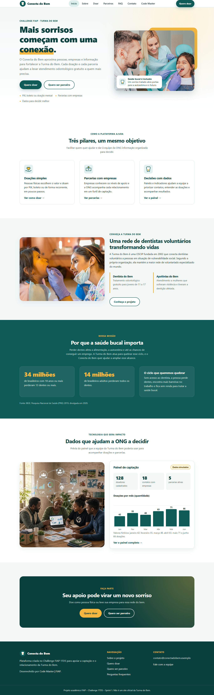 | 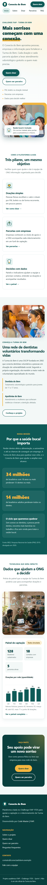 |

### Sobre
| Desktop | Celular |
|---------|---------|
| 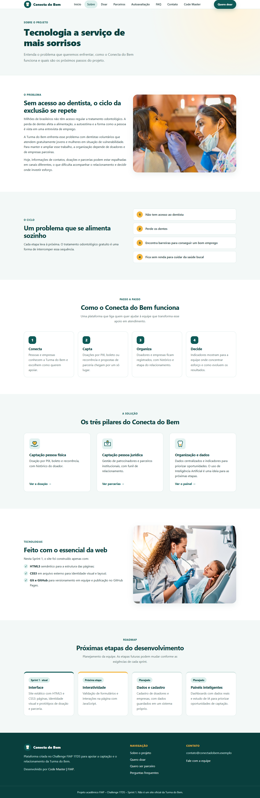 | 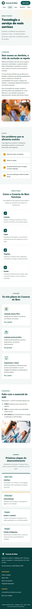 |

### Doar
| Desktop | Celular |
|---------|---------|
| 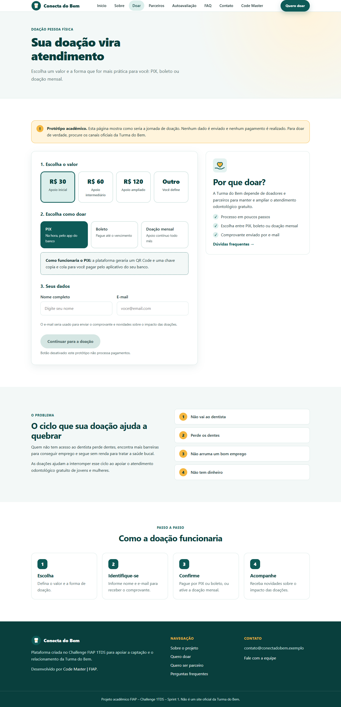 | 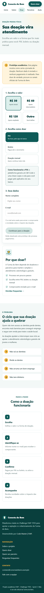 |

### Parceiros
| Desktop | Celular |
|---------|---------|
| 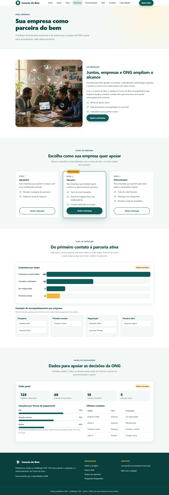 | 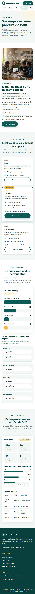 |

### Integrantes
| Desktop | Celular |
|---------|---------|
| 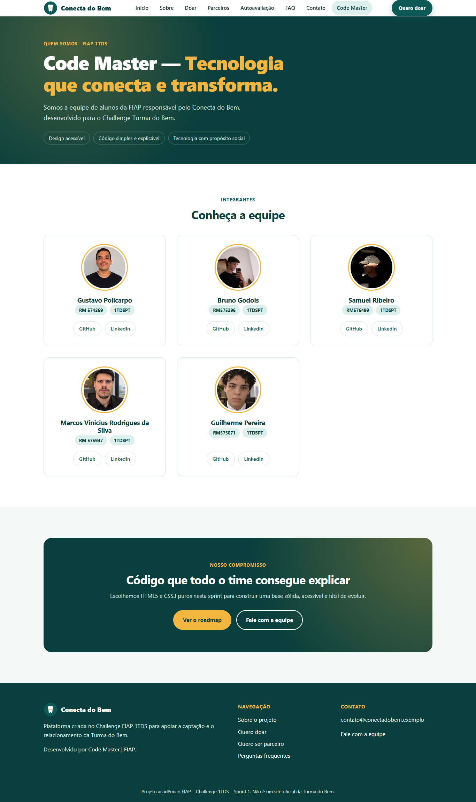 | 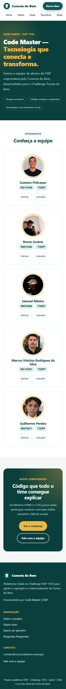 |

### FAQ
| Desktop | Celular |
|---------|---------|
| 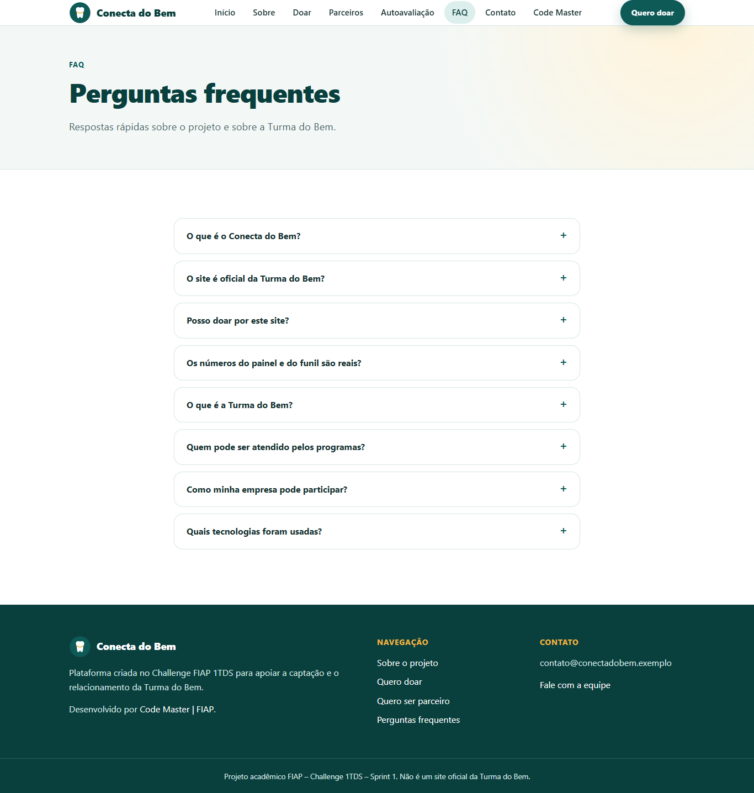 | 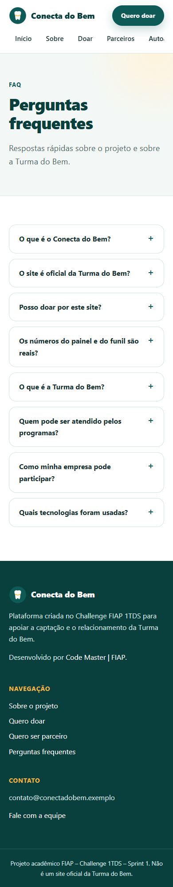 |

### Contato
| Desktop | Celular |
|---------|---------|
| 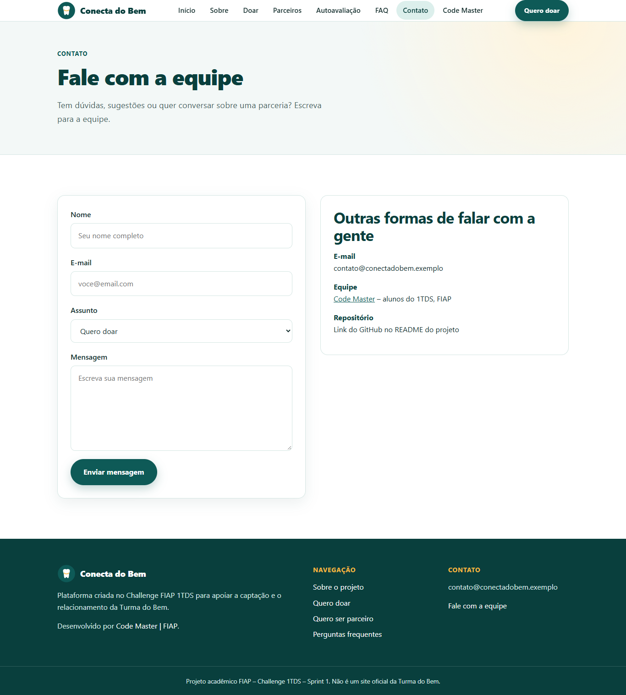 | 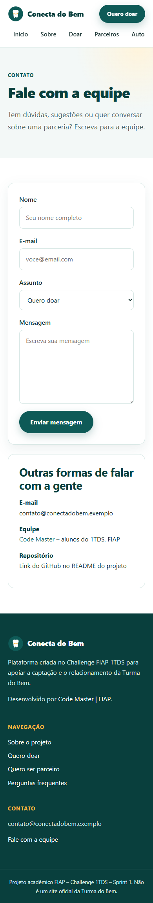 |


## Autores e créditos
| Nome | RM | Turma | GitHub | LinkedIn |
|------|----|-------|--------|----------|
| Gustavo Policarpo| RM574269| 1TDSPT | [GitHub](https://github.com/policarpogustavo) | [LinkedIn](https://www.linkedin.com/in/gupolicarpo/?isSelfProfile=true) |
| Bruno Godois | RM575296 | 1TDSPT | [GitHub](https://github.com/brunovgodois) | [LinkedIn](https://www.linkedin.com/in/brunovgodois/?isSelfProfile=true) |
| Samuel Ribeiro | RM576499 | 1TDS | [GitHub](https://github.com/SamuelRibeirodev) | [LinkedIn](https://www.linkedin.com/in/samuu-dev/) |
| Marcos Rodrigues | RM575947 | 1TDS | [GitHub](https://github.com/1Maroco) | [LinkedIn](https://www.linkedin.com/in/marcos-rodrigues-61158323b/?isSelfProfile=true) |
| Guilherme Pereira | RM575071 | 1TDSPT | [GitHub](https://github.com/guiholiv) | [LinkedIn](https://www.linkedin.com/in/guilherme-pereira-36812b385/?isSelfProfile=true) |

## Repositório
[github.com/policarpogustavo/Conecta_do_Bem_Challenge](https://github.com/policarpogustavo/Conecta_do_Bem_Challenge)

